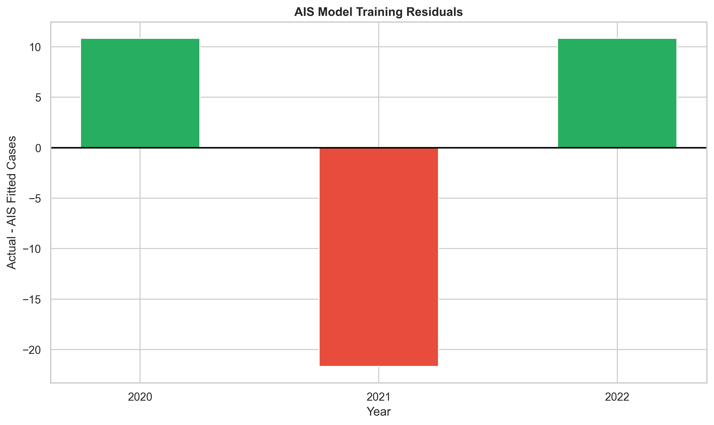

# AI-Based Lung Cancer Incidence Trend Analysis Using Machine Learning, AIS and PSO

## 📌 Project Overview

This project focuses on analyzing historical lung cancer incidence trends in India and developing an AI-assisted forecasting framework using Machine Learning and bio-inspired optimization algorithms.

The system analyzes estimated lung cancer incidence data from 2020 to 2022 and generates exploratory projections for future years up to 2030.

Three computational approaches are implemented:

1. **Linear Regression (Baseline Model)**
2. **Artificial Immune System (AIS) Optimization**
3. **Particle Swarm Optimization (PSO)**

The AIS and PSO algorithms optimize the slope and intercept of a linear trend model by minimizing Mean Squared Error (MSE).

The project also generates comparative visualizations, model evaluation metrics, historical fitting results, future projections, and optimization convergence graphs.

> **Important:** The dataset contains only three annual observations. Therefore, the future estimates are exploratory trend extrapolations rather than validated epidemiological forecasts.

---

## 🎯 Project Objectives

The primary objectives of this project are:

- Analyze historical lung cancer incidence trends in India.
- Identify changes in estimated incidence between 2020 and 2022.
- Develop a baseline Linear Regression model.
- Implement Artificial Immune System optimization using the Clonal Selection Algorithm.
- Implement Particle Swarm Optimization for model parameter estimation.
- Compare baseline, AIS, and PSO model fitting performance.
- Generate exploratory incidence projections up to 2030.
- Evaluate models using MAE, MSE, RMSE, R², and MAPE.
- Visualize model errors, trends, correlations, and optimization convergence.
- Save trained model information and experimental results for reproducibility.

---

## 📊 Dataset Description

### Dataset File

`RS_Session_258_AU_1555_C_to_D.csv`

The dataset contains estimated lung cancer incidence figures for India.

### Historical Data

| Year | Estimated Lung Cancer Cases |
|------|-----------------------------|
| 2020 | 98,278 |
| 2021 | 100,792 |
| 2022 | 103,371 |

### Dataset Characteristics

| Attribute | Description |
|-----------|-------------|
| Dataset Type | Historical incidence estimates |
| Geographic Coverage | India |
| Disease | Lung Cancer |
| Observation Period | 2020–2022 |
| Number of Observations | 3 |
| Input Feature | Year |
| Target Variable | Estimated Lung Cancer Cases |
| Forecast Horizon | 2023–2030 |
| Data Format | CSV |

### Data Trend

The estimated number of lung cancer cases increased from 98,278 in 2020 to 103,371 in 2022.

The approximate overall increase was 5.18%.

This indicates an upward trend in the available historical incidence estimates.

However, three observations are insufficient to establish a stable long-term epidemiological trend.

---

## 🧠 Algorithms Implemented

### 1. Linear Regression

Linear Regression is used as the baseline model for identifying the relationship between year and estimated lung cancer incidence.

The model follows:

\[
\hat{y} = mx + b
\]

Where:

- \(\hat{y}\) = Predicted lung cancer cases
- \(m\) = Slope
- \(x\) = Year offset
- \(b\) = Intercept

The year feature is centered using the first historical year.

\[
x = Year - BaseYear
\]

The model minimizes the sum of squared residuals.

#### Advantages

- Simple and computationally efficient.
- Easy to interpret.
- Suitable for basic trend analysis.
- Provides a baseline for optimization experiments.

#### Limitations

- Assumes a linear relationship.
- Cannot capture complex epidemiological changes.
- Sensitive to limited historical observations.

---

### 2. Artificial Immune System (AIS)

Artificial Immune System is a bio-inspired optimization technique based on mechanisms of the biological immune system.

This project implements a Clonal Selection Algorithm inspired by immune-system adaptation.

Each candidate solution, called an antibody, represents two model parameters:

\[
Antibody = [Slope, Intercept]
\]

The objective is to minimize training Mean Squared Error.

\[
MSE = \frac{1}{n}
\sum_{i=1}^{n}(y_i-\hat{y}_i)^2
\]

#### AIS Optimization Steps

1. Initialize a population of candidate antibodies.
2. Calculate the fitness of each antibody.
3. Select antibodies with the lowest prediction errors.
4. Clone selected antibodies.
5. Apply mutation to generate new candidate solutions.
6. Introduce random candidates to maintain diversity.
7. Preserve the best-performing antibodies.
8. Repeat for the configured number of generations.
9. Return the best model parameters.

#### AIS Configuration

| Parameter | Value |
|-----------|-------|
| Population Size | 40 |
| Generations | 150 |
| Elite Antibodies | 8 |
| Clones per Elite | 8 |
| Random Replacements | 6 |
| Mutation Rate | 0.15 |
| Random Seed | 42 |
| Objective Function | Mean Squared Error |

#### Advantages

- Supports population-based parameter exploration.
- Maintains candidate diversity through mutation.
- Demonstrates bio-inspired optimization.
- Provides optimization convergence information.

#### Limitations

- Computationally more expensive than ordinary Linear Regression.
- Does not guarantee better generalization.
- Performance depends on search settings.
- Provides no inherent advantage over the analytical optimum for ordinary linear least squares.

---

### 3. Particle Swarm Optimization (PSO)

Particle Swarm Optimization is a population-based optimization algorithm inspired by the collective movement of birds and fish.

Each particle represents a possible pair of regression parameters.

\[
Particle = [Slope, Intercept]
\]

Particles move through the parameter search space while tracking their personal best and the global best solutions.

#### Velocity Update

\[
v_i^{t+1} =
wv_i^t +
c_1r_1(pbest_i-x_i^t) +
c_2r_2(gbest-x_i^t)
\]

Where:

- \(w\) = Inertia weight
- \(c_1\) = Cognitive coefficient
- \(c_2\) = Social coefficient
- \(r_1,r_2\) = Random values
- \(pbest\) = Personal best position
- \(gbest\) = Global best position

#### Position Update

\[
x_i^{t+1}=x_i^t+v_i^{t+1}
\]

#### PSO Optimization Steps

1. Initialize particle positions and velocities.
2. Evaluate particle fitness.
3. Identify personal best solutions.
4. Identify the global best solution.
5. Update particle velocities.
6. Update particle positions.
7. Apply parameter boundaries.
8. Repeat until the iteration limit is reached.
9. Return the best regression parameters.

#### PSO Configuration

| Parameter | Value |
|-----------|-------|
| Number of Particles | 40 |
| Maximum Iterations | 150 |
| Inertia Weight | 0.7 |
| Cognitive Coefficient | 1.5 |
| Social Coefficient | 1.5 |
| Random Seed | 42 |
| Objective Function | Mean Squared Error |

#### Advantages

- Straightforward implementation.
- Supports continuous parameter optimization.
- Tracks optimization convergence.
- Useful for comparison with AIS.

#### Limitations

- Sensitive to parameter configuration.
- May converge prematurely in difficult optimization problems.
- Cannot overcome the limitations of insufficient training data.
- Does not improve the theoretical least-squares optimum.

---

## 🏗️ System Architecture

The project follows the workflow below:

```text
Historical Lung Cancer Dataset
               |
               v
        Data Loading
               |
               v
      Data Preprocessing
               |
               v
       Feature Extraction
               |
               v
     Baseline Linear Regression
               |
       +-------+-------+
       |               |
       v               v
 AIS Optimization   PSO Optimization
       |               |
       v               v
 AIS Model Fit      PSO Model Fit
       |               |
       +-------+-------+
               |
               v
      Model Evaluation
               |
               v
     Comparative Analysis
               |
               v
    Exploratory Forecasting
               |
               v
     Graphs and CSV Results
               |
               v
       Model Persistence
```

---

## 🛠️ Technologies Used

### Programming Language

- Python 3.10+

### Libraries

| Library | Purpose |
|---------|---------|
| NumPy | Numerical calculations |
| Pandas | Data processing |
| Scikit-learn | Baseline regression and evaluation |
| Matplotlib | Graph generation |
| Seaborn | Statistical visualization |
| h5py | HDF5 model parameter storage |
| PyYAML | Configuration management |
| Pickle | Model serialization |
| JSON | Metadata storage |

### Development Environment

- Jupyter Notebook
- Visual Studio Code
- Python
- Windows

---

## 📁 Project Structure

```text
AI-Based Lung Cancer Incidence Trend Analysis/
│
├── RS_Session_258_AU_1555_C_to_D.csv
│
├── lung_cancer_model.pkl
├── lung_cancer_model.h5
├── config.yaml
├── model_metadata.json
│
├── accuracy_graph.png
├── comparison_graph.png
├── heatmap.png
├── result.csv
├── result_graph.png
├── prediction.csv
├── prediction_graph.png
├── error_graph.png
├── model_metrics.csv
│
├── ais_model.pkl
├── ais_model.h5
├── ais_config.yaml
├── ais_model_metadata.json
├── ais_accuracy_graph.png
├── ais_comparison_graph.png
├── ais_heatmap.png
├── ais_result.csv
├── ais_result_graph.png
├── ais_prediction.csv
├── ais_prediction_graph.png
├── ais_convergence_graph.png
├── ais_error_graph.png
├── ais_model_metrics.csv
├── ais_optimization_history.csv
│
├── pso_model.pkl
├── pso_model.h5
├── pso_config.yaml
├── pso_model_metadata.json
├── pso_accuracy_graph.png
├── pso_comparison_graph.png
├── pso_heatmap.png
├── pso_result.csv
├── pso_result_graph.png
├── pso_prediction.csv
├── pso_prediction_graph.png
├── pso_convergence_graph.png
├── pso_error_graph.png
├── pso_model_metrics.csv
├── pso_optimization_history.csv
│
└── README.md
```

---

## ⚙️ Installation and Setup

### Step 1: Clone the Repository

```bash
git clone https://github.com/YOUR_USERNAME/AI-Based-Lung-Cancer-Incidence-Trend-Analysis.git
```

Replace `YOUR_USERNAME` with your GitHub username after creating the repository.

### Step 2: Navigate to the Project Directory

```bash
cd AI-Based-Lung-Cancer-Incidence-Trend-Analysis
```

### Step 3: Create a Virtual Environment

```bash
python -m venv venv
```

Activate the environment on Windows:

```bash
venv\Scripts\activate
```

### Step 4: Install Dependencies

```bash
pip install numpy pandas matplotlib seaborn scikit-learn h5py pyyaml jupyter
```

### Step 5: Configure Dataset Path

Set the dataset location in the Python scripts:

```python
PROJECT_DIR = (
    r"C:\Users\sagni\Downloads"
    r"\AI-Based Lung Cancer Incidence Trend Analysis"
)

CSV_PATH = os.path.join(
    PROJECT_DIR,
    "RS_Session_258_AU_1555_C_to_D.csv"
)
```

Update `PROJECT_DIR` when running on another computer.

---

## ▶️ Running the Project

The project is organized into three computational stages.

### Stage 1: Baseline Model

Execute the baseline Linear Regression notebook or script.

The baseline implementation:

- Loads the historical dataset.
- Preprocesses yearly incidence values.
- Trains a Linear Regression model.
- Calculates training-fit metrics.
- Generates historical fitting graphs.
- Produces future trend projections.
- Saves the model and metadata.

### Stage 2: AIS Optimization

Execute the AIS notebook or script.

The AIS implementation:

- Initializes antibody candidates.
- Optimizes regression parameters.
- Tracks convergence over generations.
- Compares AIS with the baseline.
- Generates AIS visualizations.
- Saves all outputs with the `ais_` prefix.

### Stage 3: PSO Optimization

Execute the PSO notebook or script.

The PSO implementation:

- Initializes particles and velocities.
- Optimizes regression parameters.
- Tracks personal and global best solutions.
- Generates comparative performance metrics.
- Produces PSO trend projections.
- Saves all outputs with the `pso_` prefix.

> The supplied project implementations can be run as Jupyter Notebook cells or saved as separate Python scripts.

---

## 📈 Model Evaluation Metrics

The following metrics are used to describe historical model fit.

### Mean Absolute Error (MAE)

\[
MAE = \frac{1}{n}
\sum_{i=1}^{n}|y_i-\hat{y}_i|
\]

MAE measures the average absolute difference between observed and fitted values.

### Mean Squared Error (MSE)

\[
MSE = \frac{1}{n}
\sum_{i=1}^{n}(y_i-\hat{y}_i)^2
\]

MSE penalizes larger errors more heavily.

### Root Mean Squared Error (RMSE)

\[
RMSE = \sqrt{MSE}
\]

RMSE expresses the error in the same unit as the target variable.

### Coefficient of Determination (R²)

\[
R^2 =
1-\frac{\sum(y_i-\hat{y}_i)^2}
{\sum(y_i-\bar{y})^2}
\]

R² measures the proportion of observed variation explained by the fitted model.

### Mean Absolute Percentage Error (MAPE)

\[
MAPE =
\frac{100}{n}
\sum_{i=1}^{n}
\left|
\frac{y_i-\hat{y}_i}{y_i}
\right|
\]

MAPE expresses average absolute fitting error as a percentage.

### Training Fit Percentage

The project also calculates:

\[
TrainingFit = \max(0,100-MAPE)
\]

This is a descriptive score used for visualization.

It is **not an independently validated accuracy measure**.

---

## 📊 Results and Visualization

### 1. AIS Model Error Analysis

The following visualization shows the training residuals generated by the Artificial Immune System optimized regression model.



**Figure 1: AIS Optimized Model Training Residuals**

The residual for each historical year is calculated as:

\[
Residual = ActualCases - FittedCases
\]

Interpretation:

- A residual near zero indicates a close historical fit.
- A positive residual indicates model underestimation.
- A negative residual indicates model overestimation.
- Larger absolute residuals indicate greater fitting error.

This graph helps identify how closely the AIS model represents the available historical observations.

Because the dataset contains only three years, the residual pattern should not be interpreted as evidence of reliable future forecasting performance.

---

### 2. Baseline Model Results

The baseline model generates:

- `accuracy_graph.png`
- `comparison_graph.png`
- `heatmap.png`
- `result_graph.png`
- `prediction_graph.png`
- `error_graph.png`

The comparison graph shows historical observations alongside fitted regression values.

The prediction graph displays exploratory linear projections through 2030.

---

### 3. AIS Optimization Results

The AIS model generates:

- `ais_accuracy_graph.png`
- `ais_comparison_graph.png`
- `ais_heatmap.png`
- `ais_result_graph.png`
- `ais_prediction_graph.png`
- `ais_convergence_graph.png`
- `ais_error_graph.png`

The convergence graph displays changes in the best and average population fitness across generations.

A decreasing MSE indicates improvement in the training objective.

---

### 4. PSO Optimization Results

The PSO model generates:

- `pso_accuracy_graph.png`
- `pso_comparison_graph.png`
- `pso_heatmap.png`
- `pso_result_graph.png`
- `pso_prediction_graph.png`
- `pso_convergence_graph.png`
- `pso_error_graph.png`

The convergence graph illustrates how the particle swarm approaches the best training solution.

---

## 🔬 Comparative Model Analysis

Three approaches are compared:

| Model | Optimization Method | Objective |
|-------|---------------------|-----------|
| Linear Regression | Analytical Least Squares | Minimize squared error |
| AIS | Clonal Selection | Minimize training MSE |
| PSO | Particle Swarm Optimization | Minimize training MSE |

The numerical evaluation results are stored in:

```text
model_metrics.csv
ais_model_metrics.csv
pso_model_metrics.csv
```

### Expected Mathematical Behavior

For the same linear model and training observations, ordinary least squares provides the global minimum of the squared-error objective.

Therefore, AIS and PSO are not expected to outperform the analytical Linear Regression solution on training MSE.

AIS and PSO are included to study the behavior of bio-inspired optimization methods, convergence characteristics, and computational approaches to parameter estimation.

A close match between the three methods demonstrates successful optimization rather than improved predictive generalization.

---

## 🔮 Future Lung Cancer Incidence Projections

The models generate exploratory annual projections from 2023 through 2030.

The baseline linear trend produces approximately:

| Year | Projected Cases |
|------|-----------------|
| 2023 | 105,910 |
| 2024 | 108,457 |
| 2025 | 111,003 |
| 2026 | 113,550 |
| 2027 | 116,096 |
| 2028 | 118,643 |
| 2029 | 121,189 |
| 2030 | 123,736 |

These values are extrapolated from the available historical trend.

AIS and PSO projections are generated using their respective optimized slope and intercept parameters.

The actual generated values are stored in:

```text
prediction.csv
ais_prediction.csv
pso_prediction.csv
```

### Forecasting Assumption

The forecasting models assume that the historical linear trend continues into future years.

They do not incorporate:

- Population growth and demographic changes.
- Age-standardized incidence rates.
- Tobacco consumption patterns.
- Air pollution exposure.
- Healthcare access.
- Screening and diagnostic changes.
- Public health interventions.
- Other epidemiological risk factors.

Consequently, the projections should not be interpreted as official future cancer incidence estimates.

---

## 💾 Model Storage and Output Formats

### PKL Files

```text
lung_cancer_model.pkl
ais_model.pkl
pso_model.pkl
```

These files store trained model objects or parameter dictionaries.

### H5 Files

```text
lung_cancer_model.h5
ais_model.h5
pso_model.h5
```

These HDF5 files store numerical model parameters, training data, and optimization information.

They are not TensorFlow/Keras neural network files.

### YAML Files

```text
config.yaml
ais_config.yaml
pso_config.yaml
```

These files store model configurations and algorithm settings.

### JSON Files

```text
model_metadata.json
ais_model_metadata.json
pso_model_metadata.json
```

These files store metadata, parameters, evaluation metrics, and future projection information.

### CSV Files

The generated CSV files contain:

- Historical observed and fitted cases.
- Model fitting errors.
- Exploratory future projections.
- Model evaluation metrics.
- Optimization histories.

---

## ⚠️ Limitations

### 1. Small Dataset

The dataset contains only three annual observations.

This is insufficient for reliable machine learning validation or complex forecasting.

### 2. No Independent Test Set

The available implementations evaluate the models using the same historical observations used for fitting.

The reported metrics therefore describe in-sample performance.

### 3. Linear Trend Assumption

The models assume a linear relationship between year and incidence.

Actual cancer incidence can follow nonlinear patterns.

### 4. Limited Predictive Variables

The model uses year as its only input feature.

Important demographic, environmental, behavioral, and clinical factors are not included.

### 5. Optimization Does Not Guarantee Better Forecasts

AIS and PSO optimize training error.

Reducing training error does not necessarily improve future prediction accuracy.

### 6. Limited Correlation Analysis

Correlation heatmaps calculated using three observations are statistically unstable and should be treated as exploratory visualizations.

### 7. Epidemiological Interpretation

The models do not estimate causal relationships or individual lung cancer risk.

They should not be used for clinical decisions, screening recommendations, or public health resource allocation.

---

## 🚀 Future Enhancements

Future improvements may include:

1. Collecting 10–20 years of historical cancer incidence data.
2. Incorporating state-wise and district-wise incidence information.
3. Adding demographic and environmental features.
4. Using age-standardized incidence rates.
5. Implementing time-series forecasting models such as ARIMA.
6. Exploring nonlinear regression and ensemble methods.
7. Evaluating forecasting performance using chronological validation.
8. Performing uncertainty quantification and prediction interval estimation.
9. Comparing optimization algorithms across multiple datasets.
10. Developing an interactive dashboard using Streamlit or Plotly.
11. Integrating updated data from recognized cancer surveillance sources.
12. Extending the analysis to additional cancer types.

---

## 🌍 Potential Applications

With substantially expanded and validated datasets, the framework could support:

- Exploratory public health trend analysis.
- Academic research and data visualization.
- Comparative studies of optimization algorithms.
- Educational demonstrations of forecasting workflows.
- Historical disease burden reporting.
- Research into epidemiological prediction methods.

The current implementation is intended for educational and experimental research.

---

## 📚 Research Significance

This project demonstrates the integration of traditional Machine Learning with two bio-inspired optimization algorithms.

Its primary technical contributions include:

- Implementing a reproducible linear trend analysis pipeline.
- Applying AIS Clonal Selection to regression parameter optimization.
- Applying PSO to the same regression objective.
- Recording optimization convergence.
- Comparing analytical and population-based optimization methods.
- Generating reusable model artifacts and visual reports.

The project illustrates how optimization algorithms can be integrated into a machine learning workflow while emphasizing the importance of appropriate evaluation and dataset quality.

---

## 🔁 Reproducibility

The AIS and PSO experiments use a fixed random seed:

```python
RANDOM_SEED = 42
```

This supports repeatable random initialization and optimization behavior when using compatible software versions and the same input data.

The algorithm configurations are recorded in YAML files.

Model parameters and experiment metadata are stored in PKL, H5, and JSON files.

For stronger reproducibility, future versions should also record exact package versions and the source dataset version.

---

## 📌 Conclusion

The **AI-Based Lung Cancer Incidence Trend Analysis Using Machine Learning, AIS and PSO** project provides an experimental framework for analyzing historical lung cancer incidence estimates and exploring optimization-based forecasting.

Linear Regression provides an interpretable analytical baseline, while Artificial Immune System and Particle Swarm Optimization demonstrate two population-based approaches for estimating regression parameters.

The project generates historical fitting results, optimization convergence graphs, correlation heatmaps, model metrics, and exploratory future projections.

The primary outcome is a reproducible comparative optimization workflow rather than a clinically validated forecasting model.

With expanded historical datasets, additional epidemiological variables, and independent temporal validation, the framework could be extended toward more meaningful public health forecasting research.

---

## 📄 License

This project is intended for educational, academic, and research purposes.

A formal open-source license may be added depending on the intended distribution and reuse permissions.

---

## ⭐ Acknowledgment

This project uses historical lung cancer incidence estimates for India and open-source Python libraries for data analysis, regression modeling, optimization, and visualization.

The implementation is intended to support learning and experimentation with Machine Learning, Artificial Immune Systems, and Particle Swarm Optimization.

---

**Project:** AI-Based Lung Cancer Incidence Trend Analysis Using Machine Learning, AIS and PSO

**Programming Language:** Python

**Primary Visualization:** `ais_error_graph.png`

**Optimization Algorithms:** Artificial Immune System (AIS) and Particle Swarm Optimization (PSO)

**Application Domain:** Healthcare Data Analytics and Exploratory Incidence Forecasting
